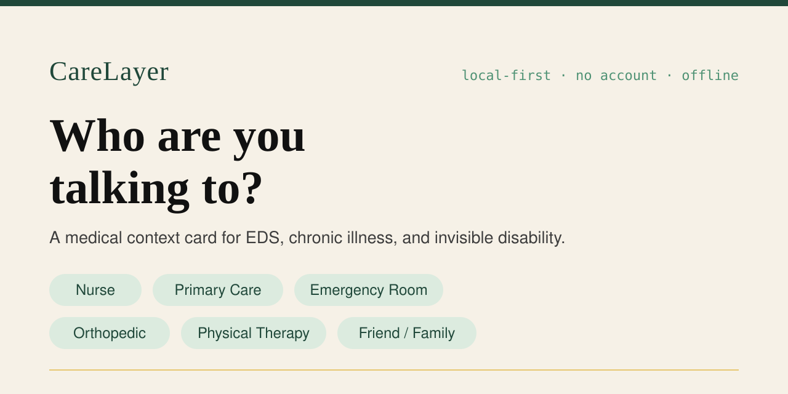

  

# CareLayer — Native iOS

**A medical context card for EDS, chronic illness, and invisible disability.**

**Live web prototype:** [becomingbeta.com/my-carelayer-app](https://becomingbeta.com/my-carelayer-app/)
**Status:** Version 1 — native rebuild of the web prototype, pre-release.

---

## Why this exists

When you are sick, in pain, or overwhelmed, you should not have to re-explain your condition, needs, and risks to every new person you meet in the healthcare system.

CareLayer asks one question — **"Who are you talking to?"** — and shows that person the right layer of your profile: a Quick Summary, why it matters, common mistakes, safety considerations, and what helps.

## How it works

1. **Build your profile once** — identity, medical context, communication and sensory needs, emergency contact.
2. **Pick the audience** — Nurse, Primary Care, Emergency Room, Orthopedic, Physical Therapy, or Friend / Family.
3. **Share, if and when you choose** — formatted text, a visual card image, or a QR code. Nothing is shared unless you tap Share.

## Principles

- **Local-first** — your profile lives only on your device (SwiftData).
- **No account** — no login, no backend, no database server.
- **No AI dependency** — fully useful offline, with no network at all.
- **User-controlled disclosure** — you decide who sees what, every time.
- **Accessibility as architecture** — Dynamic Type, VoiceOver, 44pt+ targets, reduced-motion support, non-color-only indicators.

## What's in Version 1

- 3-page onboarding (what it does / stays on your device / you control sharing), with start-empty or explore-with-sample choices
- Editable profile with chip multi-select editors
- "Who are you talking to?" home with six audience tiles
- Audience CareLayer screens with the original prototype's copy, verbatim
- Medical Alert (Emergency) Card with adhesive-sensitivity warning
- Native sharing: formatted text, visual card image, and QR code — always initiated by you
- Full offline operation

## Privacy

The sample profile ("Alexandra Morgan") is fictional demo data from the web prototype, loaded only when you choose it. No real person's medical information is in this app. See [PRIVACY-NOTES.md](PRIVACY-NOTES.md) for what data exists, where it lives, and what sharing sends.

## Getting started

See [XCODE-SETUP.md](XCODE-SETUP.md). In short: open `MyCareLayer/MyCareLayer.xcodeproj` in Xcode 15 or 16, pick your signing team, run on a simulator or device (iOS 17+).

## Documents

| Document | What it covers |
|---|---|
| [MIGRATION-AUDIT.md](MIGRATION-AUDIT.md) | What the web app did, and how it mapped here |
| [IOS-ARCHITECTURE.md](IOS-ARCHITECTURE.md) | Models, navigation, persistence, sharing, accessibility |
| [XCODE-SETUP.md](XCODE-SETUP.md) | Build and run instructions |
| [PRIVACY-NOTES.md](PRIVACY-NOTES.md) | What data exists, where it lives, what sharing sends |
| [APP-STORE-CHECKLIST.md](APP-STORE-CHECKLIST.md) | Submission checklist with open decisions |

## Not in Version 1

HealthKit, Apple Watch, Wallet pass, widgets, App Intents / Siri, medication import, encrypted cloud backup, AI summarization. The architecture leaves seams for these — see [IOS-ARCHITECTURE.md](IOS-ARCHITECTURE.md).
